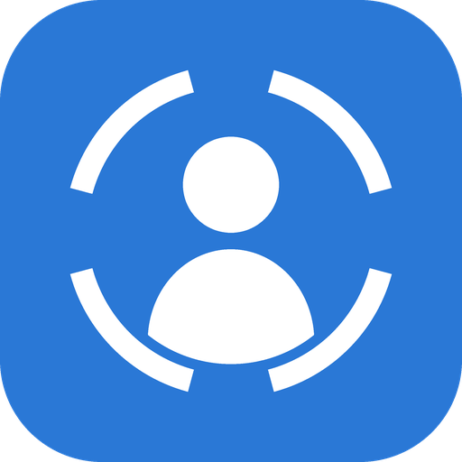
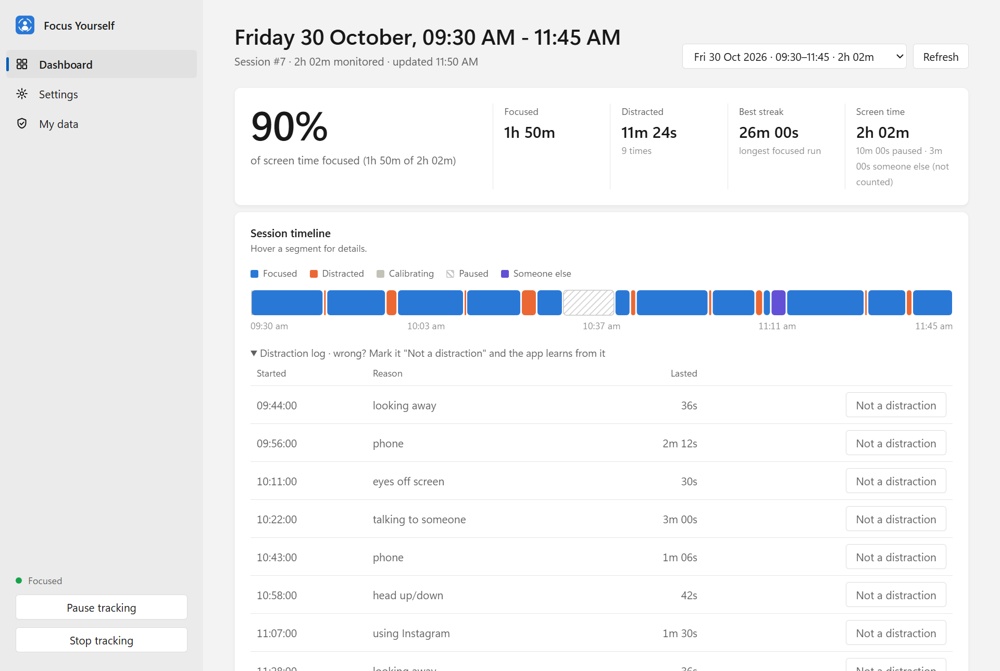
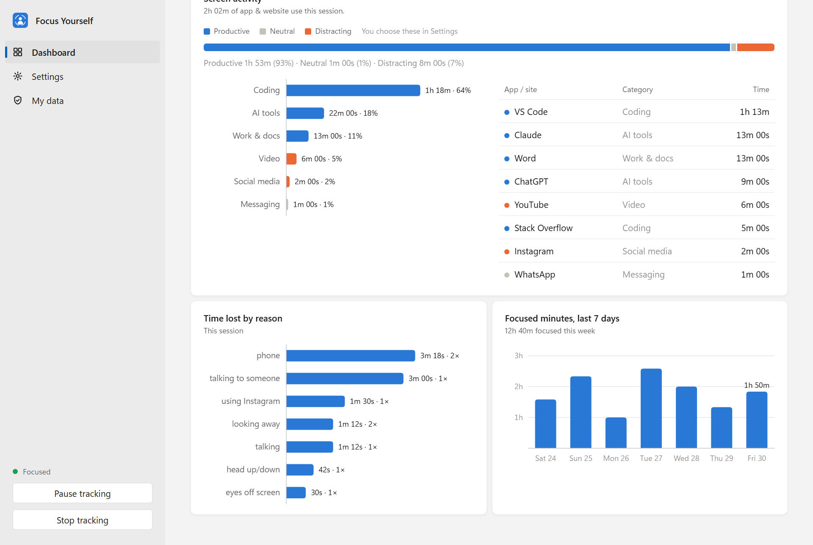
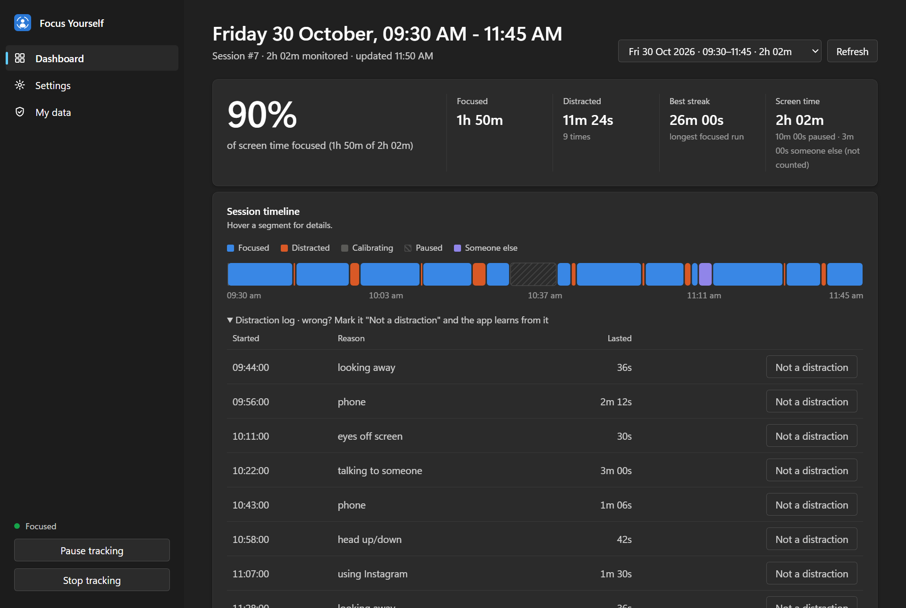

  

<h1 align="center">Focus Yourself</h1>

  A free Windows app that uses your webcam to measure real attention while you work. 
  Private, offline and easy to use.

  <a href="../../releases/latest/download/FocusYourself-Setup.exe"><b>Download for Windows</b></a>
  &nbsp;·&nbsp;
  <a href="../../releases">All releases</a>

  Windows 10 and 11 (64-bit) · About 281 MB · Free

## What it does

Most screen-time tools only count which app is open. Focus Yourself checks whether you are actually paying attention.

- **Spots real distractions:** phone use, talking, looking away, eyes closing and leaving your desk.
- **Tracks your apps:** records apps and websites by category, and you decide which are productive for you.
- **Shows your progress:** a focus score, a session timeline, each distraction with its reason and length, and your last seven days.
- **Tracks only you (optional):** register your face, and anyone else's time is logged separately.
- **Runs in the background:** starts with Windows and lives in the system tray. Pause or stop it at any time.

## Install

1. Download [FocusYourself-Setup.exe](../../releases/latest/download/FocusYourself-Setup.exe).
2. Open the file. If Windows shows "Windows protected your PC", click **More info**, then **Run anyway**. This appears because the installer is not code-signed.
3. Click **Install**. Focus Yourself starts and its icon appears next to the clock.
4. Look at your screen normally for five seconds while it learns your usual position.

To update, run a newer installer. Your data is kept.

To uninstall, open Windows **Settings › Apps › Installed apps**, find Focus Yourself and choose **Uninstall**.

## System requirements

| Item | Requirement |
| --- | --- |
| Operating system | Windows 10 or Windows 11, 64-bit |
| Processor | Intel Core i3 / AMD Ryzen 3 or better |
| Memory | 4 GB RAM (8 GB recommended) |
| Disk space | 1.5 GB free |
| Camera | Built-in or USB webcam facing you |
| Internet | Only to download the installer |

## Privacy

- Camera images are analysed in memory and never saved.
- Nothing is sent over the internet. There are no accounts and no cloud sync.
- Window titles are never stored, only app names and categories.
- Face registration stores a set of numbers, never a photo.
- All data stays in one folder on your PC, and you can delete it from the **My data** page.

## Light and dark theme

## About this repository

This repository holds the Windows installer and this page. The source code is not public. The app is free to download and use.

Focus Yourself uses open-source components, including OpenCV, MediaPipe, YOLOX, SQLite and pywebview, each under its own licence. It is a personal productivity tool, not a medical device.

## Developer

Built by **Viswajith S**. Connect on [LinkedIn](https://www.linkedin.com/in/viswajjiith/).
